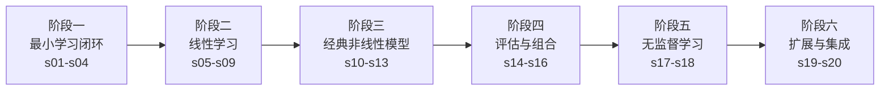
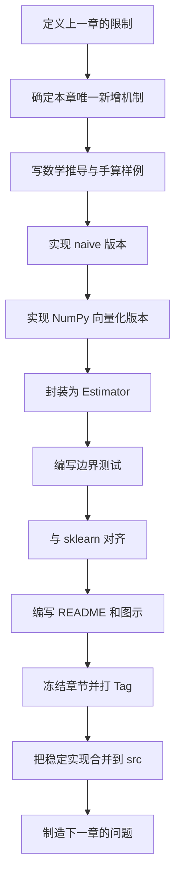

# 总体方案：把 `learn-claude-code` 的教学模式迁移到“从零实现 scikit-learn”

最合适的设计不是按 `sklearn.linear_model`、`sklearn.tree`、`sklearn.cluster` 逐个堆算法，而是复用 `learn-claude-code` 的核心教学思想：

> **确定一个始终不变的最小内核，每一章只增加一个机制，最后再将全部机制组合成完整系统。**

`learn-claude-code` 当前主线采用根目录下 `s01` 到 `s20` 的渐进式课程：每章增加一个机制，包含独立可运行代码、叙述性 README 和必要的图示；最后的 `s20` 不再发明新机制，而是把前面所有组件重新放回一个完整系统。([GitHub][1])

迁移到机器学习教程后，可以把项目命名为：

```text
learn-sklearn-from-scratch
```

核心口号可以设计为：

```text
One Estimator & NumPy is all you need.

一个 Estimator 协议 + NumPy，
就能逐步构建一个迷你 scikit-learn。
```

---

# 一、首先确定“不变的核心”

## 1. `learn-claude-code` 的不变核心

它始终保持：

```python
while True:
    response = llm(messages, tools)

    if not has_tool_use(response):
        break

    results = execute_tools(response)
    messages.append(results)
```

工具、权限、记忆、任务和团队机制都围绕这个循环扩展，而不是不断重写循环。([GitHub][2])

## 2. mini-sklearn 的不变核心

机器学习框架对应的不变核心不是某个梯度下降循环，因为决策树、KNN、PCA、线性回归的训练过程并不相同。

真正稳定的核心应该是：

```text
Estimator 生命周期协议
```

即：

```python
model = Estimator(**hyperparameters)

model.fit(X_train, y_train)

predictions = model.predict(X_test)
```

完整生命周期为：

```text
初始化超参数
    ↓
验证输入数据
    ↓
学习模型参数
    ↓
保存 fitted attributes
    ↓
检查模型是否已训练
    ↓
预测或变换新数据
    ↓
评估结果
```

scikit-learn 的公共设计也以 Estimator 为中心，并区分 Estimator、Predictor、Transformer 和 Model；`Pipeline`、`GridSearchCV` 则属于包装其他估计器的 Meta-estimator。([Scikit-learn][3])

因此本教程的稳定内核可以表述为：

```text
MiniSklearn Core
    =
Estimator Protocol
    + Data Contract
    + Fitted State
```

对应伪代码：

```python
class MeanRegressor:
    def __init__(self):
        pass

    def fit(self, X, y):
        X, y = check_X_y(X, y)

        self.constant_ = y.mean()
        self.n_features_in_ = X.shape[1]

        return self

    def predict(self, X):
        check_is_fitted(self, "constant_")
        X = check_array(X)

        return np.full(X.shape[0], self.constant_)
```

后面的所有模型都不改变调用方式：

```python
LinearRegression().fit(X, y)
LogisticRegression().fit(X, y)
DecisionTreeClassifier().fit(X, y)
KMeans().fit(X)
PCA().fit_transform(X)
```

---

# 二、项目的两条演进主线

教程需要同时运行两条路线。

## 算法演进线

```text
统计基线
→ 线性模型
→ 概率分类
→ 距离学习
→ 概率生成模型
→ 决策树
→ 集成学习
→ 核方法
→ 聚类
→ 降维
```

## 框架演进线

```text
普通函数
→ Estimator 对象
→ 数据验证
→ Transformer
→ Predictor
→ Metrics
→ Cross Validation
→ Meta-estimator
→ Pipeline
→ GridSearch
→ 第三方 Estimator
```

两个维度最终汇合：

```text
算法解决“如何学习”
框架解决“如何可靠地使用学习算法”
```

---

# 三、建议采用 20 章主线

整体分成六个阶段：



---

# 四、20 个章节的具体路线

## 阶段一：建立最小机器学习闭环

### s01：Minimal Estimator——一个 `fit` 和一个 `predict` 就够了

对应模块：

```text
sklearn.dummy
sklearn.base
```

核心模型：

```python
MeanRegressor
MostFrequentClassifier
```

新增机制：

```text
训练状态
```

本章回答：

* 模型训练到底保存了什么？
* 超参数和训练参数有什么区别？
* 为什么训练属性使用 `_` 结尾？
* 为什么 `fit()` 返回 `self`？
* 为什么需要基线模型？

核心口号：

> 一个 `fit` 加一个 `predict`，就是最小可运行模型。

代码控制在 50～80 行。

运行方式：

```bash
python s01_minimal_estimator/code.py
```

输出：

```text
Train mean: 3.52
Predictions: [3.52, 3.52, 3.52]
R²: -0.08
```

下一章制造的问题：

```text
现在模型能训练，但每个模型都可能使用不同的接口。
怎样让所有模型保持一致？
```

---

### s02：Estimator Protocol——新增模型，不改变调用方式

对应模块：

```text
sklearn.base
```

新增：

```python
BaseEstimator
RegressorMixin
ClassifierMixin
TransformerMixin
get_params()
set_params()
clone()
```

核心口号：

> 新增模型，只增加一个 Estimator，不修改调用框架。

`learn-claude-code` 的 s02 将单一 Bash 调用改造成工具定义与 Handler 映射，新增工具时不再修改 Agent Loop；机器学习教程中对应的设计是：新增算法只实现统一 Estimator 协议，不修改训练、评估和搜索框架。([GitHub][4])

示例：

```python
model = MeanRegressor(strategy="mean")

print(model.get_params())
# {"strategy": "mean"}

copied = clone(model)
```

本章只解决 API，不实现复杂算法。

---

### s03：Data Contract——先校验数据，再学习参数

对应模块：

```text
sklearn.utils.validation
sklearn.utils
```

新增：

```python
check_array()
check_X_y()
check_is_fitted()
check_consistent_length()
check_random_state()
```

统一规则：

```text
X：二维数组，形状为 (n_samples, n_features)
y：一维或二维目标
训练和预测的特征数量必须一致
NaN 和 Inf 默认不允许
随机过程必须支持 random_state
```

核心口号：

> 模型可以不同，输入契约必须相同。

本章故意设计失败实验：

```python
model.fit([1, 2, 3], [1, 2])
model.predict([[1, np.nan]])
model.predict(X_with_wrong_feature_count)
```

要求产生明确错误，而不是底层 NumPy 的模糊异常。

---

### s04：First Evaluation Loop——训练、预测、评估形成闭环

对应模块：

```text
sklearn.datasets
sklearn.model_selection
sklearn.metrics
```

新增：

```python
train_test_split()
mean_squared_error()
mean_absolute_error()
r2_score()
accuracy_score()
confusion_matrix()
```

形成第一个完整工作流：

```python
X, y = make_regression(random_state=42)

X_train, X_test, y_train, y_test = train_test_split(
    X,
    y,
    test_size=0.2,
    random_state=42,
)

model = MeanRegressor()
model.fit(X_train, y_train)

prediction = model.predict(X_test)
score = r2_score(y_test, prediction)
```

核心口号：

> 没有独立测试集，就没有可信的模型效果。

---

## 阶段二：从统计基线进入线性学习

### s05：Transformer——让数据处理也遵守 Estimator 协议

对应模块：

```text
sklearn.preprocessing
sklearn.impute
```

新增：

```python
StandardScaler
MinMaxScaler
SimpleImputer
TransformerMixin
fit_transform()
inverse_transform()
```

核心工作流：

```python
scaler = StandardScaler()

scaler.fit(X_train)

X_train_scaled = scaler.transform(X_train)
X_test_scaled = scaler.transform(X_test)
```

关键教学点：

```text
fit：学习训练集的均值和标准差
transform：使用已经学习的统计量变换数据
```

必须展示错误写法：

```python
# 错误：测试集重新计算了均值和方差
X_test_scaled = StandardScaler().fit_transform(X_test)
```

核心口号：

> Transformer 学习数据状态，但不预测目标。

---

### s06：Linear Regression——从均值预测到线性关系

对应模块：

```text
sklearn.linear_model
```

实现三层版本：

```text
版本 A：一元线性回归解析公式
版本 B：正规方程
版本 C：SVD 或伪逆
```

统一接口：

```python
model = LinearRegression(fit_intercept=True)
model.fit(X, y)

print(model.coef_)
print(model.intercept_)
```

本章新增的不是框架机制，而是第一个真正学习参数的算法：

```text
y = Xw + b
```

需要展示：

* 一元回归
* 多元回归
* 截距项
* 共线性
* 奇异矩阵
* 伪逆为什么比直接求逆稳定

核心口号：

> 数据不再只决定一个常数，而是决定一组参数。

---

### s07：Optimization Engine——解析解不够时，迭代求解

对应模块：

```text
sklearn.linear_model
sklearn.utils.optimize
```

实现：

```python
MSELoss
GradientDescent
StochasticGradientDescent
MiniBatchGradientDescent
LearningRateSchedule
```

抽象优化流程：

```python
weights = initialize_parameters()

for iteration in range(max_iter):
    prediction = X @ weights
    loss = loss_function(y, prediction)
    gradient = compute_gradient(X, y, prediction)

    weights -= learning_rate * gradient

    if converged:
        break
```

新增训练属性：

```python
coef_
loss_curve_
n_iter_
converged_
```

扩展：

```text
Ridge：MSE + L2
Lasso：MSE + L1
ElasticNet：MSE + L1 + L2
```

核心口号：

> 优化器负责寻找参数，模型负责定义目标。

---

### s08：Logistic Regression——从连续值到概率分类

对应模块：

```text
sklearn.linear_model
```

新增：

```python
sigmoid()
binary_cross_entropy()
predict_proba()
decision_function()
classes_
```

模型流程：

```text
Xw + b
  ↓
Sigmoid
  ↓
类别概率
  ↓
阈值判断
  ↓
分类标签
```

接口：

```python
classifier = LogisticRegression()
classifier.fit(X_train, y_train)

probabilities = classifier.predict_proba(X_test)
prediction = classifier.predict(X_test)
```

必须解决：

* 标签不一定是 `0/1`
* Sigmoid 数值溢出
* 概率必须处于 `[0, 1]`
* `predict()` 与 `predict_proba()` 的区别
* 类别不平衡对准确率的影响

---

### s09：Multiclass——二分类器如何处理多个类别

对应模块：

```text
sklearn.multiclass
sklearn.preprocessing
```

实现两条路线：

```text
One-vs-Rest
Softmax Regression
```

新增：

```python
LabelEncoder
OneVsRestClassifier
SoftmaxRegression
```

这一章第一次引入 Meta-estimator：

```python
classifier = OneVsRestClassifier(
    LogisticRegression()
)
```

其内部关系：

```text
OneVsRestClassifier
    ├── LogisticRegression: class A vs others
    ├── LogisticRegression: class B vs others
    └── LogisticRegression: class C vs others
```

核心口号：

> 不修改基础二分类器，用包装器扩展能力。

---

## 阶段三：经典非线性学习方法

### s10：Pairwise and KNN——模型也可以不学习显式参数

对应模块：

```text
sklearn.metrics.pairwise
sklearn.neighbors
```

实现：

```python
euclidean_distances()
manhattan_distances()
cosine_similarity()

KNeighborsClassifier
KNeighborsRegressor
```

演进过程：

```text
Python 双循环
→ NumPy 广播
→ 矩阵距离公式
→ 分块距离计算
```

本章展示一种与线性模型完全不同的学习方式：

```text
fit：保存训练数据
predict：搜索最近邻
```

核心口号：

> 有些模型训练很轻，推理很重。

---

### s11：Naive Bayes——从距离判断转向概率推断

对应模块：

```text
sklearn.naive_bayes
```

实现：

```python
GaussianNB
MultinomialNB
BernoulliNB
```

核心计算：

```text
P(y | x) ∝ P(y) × P(x | y)
```

必须使用对数空间：

```python
log_posterior = log_prior + log_likelihood
```

而不是直接连乘小概率。

核心口号：

> 强假设可以换来简单、快速和稳定。

---

### s12：Decision Tree——用递归规则学习非线性边界

对应模块：

```text
sklearn.tree
```

第一版只实现：

```python
DecisionTreeClassifier(
    criterion="gini",
    max_depth=None,
)
```

节点：

```python
@dataclass
class TreeNode:
    feature_index: int | None = None
    threshold: float | None = None
    left: "TreeNode | None" = None
    right: "TreeNode | None" = None
    value: object | None = None
```

训练递归：

```text
当前样本
  ↓
枚举特征和阈值
  ↓
选择最佳划分
  ↓
构建左子树
  ↓
构建右子树
```

后续逐步添加：

```text
Entropy
回归树
max_depth
min_samples_split
min_samples_leaf
feature_importances_
剪枝
```

核心口号：

> 一次划分很弱，递归划分形成复杂边界。

---

### s13：Ensemble——一棵树不稳定，就组合多棵树

对应模块：

```text
sklearn.ensemble
```

内部再分三个小版本：

```text
s13.1 Bagging
s13.2 Random Forest
s13.3 AdaBoost
```

实现：

```python
BaggingClassifier
RandomForestClassifier
AdaBoostClassifier
```

随机森林结构：

```text
训练集
 ├── Bootstrap 1 → Tree 1
 ├── Bootstrap 2 → Tree 2
 ├── Bootstrap 3 → Tree 3
 └── Bootstrap N → Tree N
                     ↓
                  多数投票
```

新增通用能力：

```python
estimators_
feature_importances_
oob_score_
```

核心口号：

> 多个不稳定模型，可以组成更稳定的模型。

---

## 阶段四：从算法集合升级为机器学习框架

### s14：Cross Validation——一次划分不能代表真实能力

对应模块：

```text
sklearn.model_selection
sklearn.metrics
```

实现：

```python
KFold
StratifiedKFold
cross_val_score
cross_validate
make_scorer
```

关键约束：

```text
每个 Fold 都必须 clone 一个新模型
每个 Fold 都重新 fit
不能复用上一个 Fold 的训练状态
```

流程：

```text
Estimator
   ↓ clone
Fold 1 → fit → score
Fold 2 → fit → score
Fold 3 → fit → score
   ↓
平均分与方差
```

核心口号：

> 评估的是算法，不是某一次幸运的数据划分。

---

### s15：Grid Search——模型选择也是一个 Estimator

对应模块：

```text
sklearn.model_selection
```

实现：

```python
ParameterGrid
GridSearchCV
RandomizedSearchCV
```

接口：

```python
search = GridSearchCV(
    estimator=DecisionTreeClassifier(),
    param_grid={
        "max_depth": [2, 4, 8, None],
        "min_samples_split": [2, 5, 10],
    },
    cv=5,
)

search.fit(X, y)

print(search.best_params_)
print(search.best_score_)
print(search.best_estimator_)
```

新增：

```python
best_params_
best_score_
best_estimator_
cv_results_
```

核心口号：

> 搜索器包装模型，但对外仍然是一个模型。

---

### s16：Pipeline and Compose——把数据处理和模型组合起来

对应模块：

```text
sklearn.pipeline
sklearn.compose
```

实现：

```python
Pipeline
make_pipeline
ColumnTransformer
```

完整调用：

```python
pipeline = Pipeline([
    ("scaler", StandardScaler()),
    ("classifier", LogisticRegression()),
])

pipeline.fit(X_train, y_train)
prediction = pipeline.predict(X_test)
```

嵌套参数：

```python
pipeline.set_params(
    classifier__learning_rate=0.01,
    classifier__max_iter=1000,
)
```

完整组合：

```python
search = GridSearchCV(
    Pipeline([
        ("scaler", StandardScaler()),
        ("classifier", LogisticRegression()),
    ]),
    {
        "classifier__learning_rate": [0.1, 0.01],
        "classifier__max_iter": [100, 500],
    },
)
```

最终解决数据泄漏：

```text
每个交叉验证 Fold：
    只在当前训练 Fold 上拟合 StandardScaler
    再变换训练 Fold 和验证 Fold
```

核心口号：

> 预处理、模型和搜索必须处在同一个训练边界内。

---

## 阶段五：没有标签时如何学习

### s17：K-Means——没有 y，也可以发现结构

对应模块：

```text
sklearn.cluster
```

实现版本：

```text
随机初始化
→ K-Means++
→ 多次初始化
→ 空簇恢复
→ Mini-Batch
```

接口：

```python
model = KMeans(
    n_clusters=3,
    random_state=42,
)

labels = model.fit_predict(X)

print(model.cluster_centers_)
print(model.inertia_)
```

核心循环：

```text
初始化中心
  ↓
分配样本
  ↓
更新中心
  ↓
判断收敛
  ↓
继续或停止
```

核心口号：

> 监督学习拟合答案，无监督学习寻找结构。

---

### s18：PCA——从样本分组进入特征表示学习

对应模块：

```text
sklearn.decomposition
```

实现顺序：

```text
协方差矩阵特征分解
→ SVD
→ explained_variance_
→ explained_variance_ratio_
→ inverse_transform()
→ whitening
```

接口：

```python
pca = PCA(n_components=2)

X_reduced = pca.fit_transform(X)
X_reconstructed = pca.inverse_transform(X_reduced)
```

需要专门处理：

```text
特征向量符号不唯一
```

因此与 sklearn 比较时不能简单逐元素断言：

```python
assert np.allclose(our_components, sklearn_components)
```

而应比较：

```text
重构误差
解释方差
子空间投影
```

核心口号：

> 降维不是删除数据，而是寻找新的坐标系。

---

## 阶段六：可扩展框架与最终集成

### s19：External Estimator——能力不够时，新增模型，不修改框架

这一章对应 `learn-claude-code` 的 MCP 扩展思想：外部能力接入已有工具池，而不是改写 Agent Loop。`learn-claude-code` 的 s19/s20 会把动态 MCP 工具组装进统一工具池；机器学习版本则让第三方 Estimator 通过统一协议接入 Pipeline、Cross Validation 和 Grid Search。([GitHub][5])

示例外部模型：

```text
extensions/
└── linear_svm/
    ├── estimator.py
    ├── README.md
    └── tests.py
```

只要实现：

```python
class LinearSVM(BaseEstimator, ClassifierMixin):
    def __init__(
        self,
        learning_rate=0.01,
        regularization=1.0,
        max_iter=1000,
    ):
        ...

    def fit(self, X, y):
        ...
        return self

    def decision_function(self, X):
        ...

    def predict(self, X):
        ...
```

就可以自动进入：

```python
pipeline = Pipeline([
    ("scaler", StandardScaler()),
    ("classifier", LinearSVM()),
])

search = GridSearchCV(
    pipeline,
    {
        "classifier__regularization": [0.01, 0.1, 1.0],
    },
)
```

本章还实现：

```python
check_estimator()
check_cloneable()
check_fit_returns_self()
check_no_state_before_fit()
check_prediction_shape()
```

核心口号：

> 框架扩展的是协议，不是算法白名单。

---

### s20：Comprehensive Mini-sklearn——全部机制，归到一个 Estimator 体系

与 `learn-claude-code` 的综合章相同，s20 不再加入新算法，而是把全部组件组合起来。原项目的综合章将权限、工具、任务、记忆、压缩、团队和插件重新放回同一个循环；mini-sklearn 的综合章则把数据、预处理、模型、评估、搜索和解释放回同一个 Estimator 生命周期。([GitHub][5])

完整流程：

```text
加载数据
  ↓
识别数值与类别特征
  ↓
划分训练集与测试集
  ↓
ColumnTransformer
  ├── 数值：Imputer → StandardScaler
  └── 类别：Imputer → OneHotEncoder
  ↓
Pipeline
  ↓
GridSearchCV
  ↓
Cross Validation
  ↓
best_estimator_
  ↓
测试集评估
  ↓
特征重要性或系数解释
  ↓
模型持久化
```

伪代码：

```python
numeric_pipeline = Pipeline([
    ("imputer", SimpleImputer(strategy="mean")),
    ("scaler", StandardScaler()),
])

categorical_pipeline = Pipeline([
    ("imputer", SimpleImputer(strategy="most_frequent")),
    ("encoder", OneHotEncoder()),
])

preprocessor = ColumnTransformer([
    ("numeric", numeric_pipeline, numeric_columns),
    ("category", categorical_pipeline, categorical_columns),
])

pipeline = Pipeline([
    ("preprocessor", preprocessor),
    ("classifier", RandomForestClassifier(random_state=42)),
])

search = GridSearchCV(
    pipeline,
    {
        "classifier__n_estimators": [10, 50],
        "classifier__max_depth": [3, 6, None],
    },
    cv=5,
    scoring="accuracy",
)

search.fit(X_train, y_train)

prediction = search.predict(X_test)
```

最终核心仍然没有变化：

```text
Estimator
    ↓
fit
    ↓
fitted attributes
    ↓
predict / transform
```

---

# 五、推荐的仓库目录

```text
learn-sklearn-from-scratch/
├── README.md
├── README.en.md
├── pyproject.toml
├── requirements.txt
│
├── s01_minimal_estimator/
│   ├── README.md
│   ├── README.en.md
│   ├── code.py
│   ├── test_code.py
│   ├── exercises.py
│   └── images/
│
├── s02_estimator_protocol/
├── s03_data_validation/
├── s04_evaluation_loop/
├── s05_transformer/
├── s06_linear_regression/
├── s07_optimization/
├── s08_logistic_regression/
├── s09_multiclass/
├── s10_neighbors/
├── s11_naive_bayes/
├── s12_decision_tree/
├── s13_ensemble/
├── s14_cross_validation/
├── s15_grid_search/
├── s16_pipeline/
├── s17_kmeans/
├── s18_pca/
├── s19_external_estimator/
├── s20_comprehensive/
│
├── src/
│   └── mini_sklearn/
│       ├── base.py
│       ├── utils/
│       ├── datasets/
│       ├── preprocessing/
│       ├── metrics/
│       ├── model_selection/
│       ├── linear_model/
│       ├── neighbors/
│       ├── naive_bayes/
│       ├── tree/
│       ├── ensemble/
│       ├── cluster/
│       ├── decomposition/
│       ├── pipeline.py
│       └── compose.py
│
├── extensions/
│   ├── svm/
│   ├── dbscan/
│   ├── mixture/
│   └── neural_network/
│
├── tests/
│   ├── api/
│   ├── numerical/
│   ├── parity/
│   ├── integration/
│   └── regression/
│
├── benchmarks/
├── examples/
├── notebooks/
└── web/
```

---

# 六、采用“双轨代码结构”

直接照搬每章一份完整框架代码，会产生大量重复；完全使用共享包，又会让学习者看不到每一章具体增加了什么。

因此建议采用两条代码轨道。

## 教学轨道

```text
s01...s20/code.py
```

特点：

* 每章独立运行
* 只保留本章核心
* 代码优先可读
* 可以适度重复
* 不做复杂性能优化
* 不依赖前一章目录

例如：

```bash
python s06_linear_regression/code.py
python s12_decision_tree/code.py
python s20_comprehensive/code.py
```

## 框架轨道

```text
src/mini_sklearn/
```

特点：

* 不重复实现公共逻辑
* 使用正式包结构
* 保留类型注解
* 支持完整测试
* 最终由 s20 使用
* 逐步接近工程实现

两者关系：

```text
教学 code.py
    解释原理、突出机制
           ↓
src/mini_sklearn
    整合、复用、稳定化
```

这和“教学实现不是生产实现”的思想一致。`learn-claude-code` 明确说明其部分生产机制被有意简化或省略，以保持学习路线清晰。([GitHub][1])

---

# 七、每一章统一使用同一种 README 模板

`learn-claude-code` 的章节通常从上一章的问题开始，给出解决方案、工作原理、可运行实验、相对上一章的变化、下一章引子，以及教学版与生产实现的差异。([GitHub][2])

mini-sklearn 可以固定为以下格式。

```text
# sXX：章节名称

> 本章口号
> 对应 sklearn 模块

## 1. 上一章留下的问题

## 2. 本章目标

## 3. 数学直觉

## 4. 数学定义

## 5. 最小实现

## 6. NumPy 向量化实现

## 7. scikit-learn 风格封装

## 8. 相对上一章的变化

## 9. 运行实验

## 10. 与 sklearn 对比

## 11. 失败案例和边界条件

## 12. 教学实现与生产实现的差距

## 13. 练习题

## 14. 下一章
```

---

# 八、每章只增加一个主要机制

这是整个项目最重要的约束。

不合适的章节：

```text
s06：
线性回归
+ Ridge
+ Lasso
+ Logistic Regression
+ Softmax
+ Grid Search
```

这种设计会让读者不知道是哪一部分带来了变化。

更合理的划分：

```text
s06：模型如何学习线性参数
s07：参数如何通过迭代优化
s08：线性得分如何变成概率
s09：二分类器如何扩展到多分类
```

建议设置代码规模限制：

| 类型           |         建议规模 |
| ------------ | -----------: |
| 简单章节         |     80～150 行 |
| 普通章节         |    150～300 行 |
| 决策树、Pipeline |    300～500 行 |
| s20 综合章      | 可以超过 1,000 行 |
| 单章新增核心代码     |  尽量不超过 200 行 |

---

# 九、每章都要提供“相对上一章的变更表”

例如 s08：

| 组件           | s07       | s08             |
| ------------ | --------- | --------------- |
| 任务类型         | 回归        | 二分类             |
| 线性输出         | 任意实数      | 决策分数            |
| 激活函数         | 无         | Sigmoid         |
| 损失函数         | MSE       | Log Loss        |
| 新接口          | `predict` | `predict_proba` |
| 标签管理         | 连续值       | `classes_`      |
| Estimator 协议 | 不变        | 不变              |

这一部分相当于告诉学习者：

```text
哪些地方发生变化
哪些地方始终没有变化
```

---

# 十、每个算法保留三层实现

## 第一层：Naive

```text
naive.py
```

目的：

* 看清楚数学逻辑
* 可以使用 Python 循环
* 不追求性能

## 第二层：Vectorized

```text
vectorized.py
```

目的：

* 使用 NumPy 广播和矩阵运算
* 理解批量计算
* 比较性能差异

## 第三层：Robust

```text
robust.py
```

目的：

* 数值稳定
* 边界检查
* 随机状态
* 早停
* 异常处理
* 大数据分块

例如逻辑回归：

```text
naive.py
    普通 Sigmoid
    全批量梯度下降

vectorized.py
    向量化梯度
    批量概率输出

robust.py
    稳定 Sigmoid
    LogSumExp
    正则化
    early stopping
    random_state
```

---

# 十一、测试体系

## 1. 数学单元测试

```text
tests/numerical/
```

验证：

* 手算小样本
* 数值梯度
* 损失函数
* 距离
* 信息熵
* Gini 系数
* 协方差
* 特征分解

## 2. API 协议测试

```text
tests/api/
```

例如：

```python
def test_fit_returns_self():
    model = LinearRegression()
    result = model.fit(X, y)

    assert result is model
```

```python
def test_init_contains_only_hyperparameters():
    model = LogisticRegression(max_iter=100)

    assert not hasattr(model, "coef_")
```

```python
def test_predict_before_fit_fails():
    model = DecisionTreeClassifier()

    with pytest.raises(NotFittedError):
        model.predict(X)
```

scikit-learn 官方开发指南同样强调 estimator 的实例化、拟合属性、`get_params`、`set_params`、克隆、输入验证和随机数约定。([Scikit-learn][6])

## 3. sklearn 对齐测试

```text
tests/parity/
```

scikit-learn 只作为开发测试依赖：

```python
from sklearn.linear_model import LinearRegression as SkLinearRegression
```

比较：

```python
assert_allclose(
    our_model.predict(X_test),
    sklearn_model.predict(X_test),
    rtol=1e-5,
    atol=1e-7,
)
```

特殊算法使用不变量比较：

| 算法      | 不应直接比较 | 应比较         |
| ------- | ------ | ----------- |
| K-Means | 聚类标签编号 | 调整后的聚类结果、惯性 |
| PCA     | 特征向量符号 | 子空间、解释方差、重构 |
| 决策树     | 完全相同结构 | 预测、深度、叶节点性质 |
| 神经网络    | 单个权重   | 损失下降、预测性能   |
| 随机森林    | 每棵树结构  | 总体预测、统计表现   |

## 4. 集成测试

```text
tests/integration/
```

重点验证：

```text
Scaler + LogisticRegression
Pipeline + CrossValidation
Pipeline + GridSearchCV
ColumnTransformer + RandomForest
External Estimator + Pipeline
```

---

# 十二、开发一个章节的标准流程

每一章按照固定流水线推进：



对应 Git 流程：

```bash
git checkout -b chapter/s06-linear-regression

# 实现教学版本
s06_linear_regression/code.py

# 实现正式版本
src/mini_sklearn/linear_model/_linear_regression.py

# 测试
pytest s06_linear_regression/
pytest tests/parity/test_linear_regression.py

# 冻结章节
git tag s06-linear-regression
```

章节一旦发布：

```text
不回头重构教学代码
```

确需修复时只处理：

* 明确错误
* 安全问题
* 无法运行
* 文档与代码不一致

否则保留其历史状态，让学习者能看清演化过程。

---

# 十三、版本与章节映射

| 发布版本   | 章节      | 目标                 |
| ------ | ------- | ------------------ |
| `v0.1` | s01～s04 | 最小监督学习闭环           |
| `v0.2` | s05～s09 | 预处理和线性学习           |
| `v0.3` | s10～s13 | 经典非线性模型            |
| `v0.4` | s14～s16 | 交叉验证、搜索、Pipeline   |
| `v0.5` | s17～s18 | 无监督学习              |
| `v0.9` | s19     | 第三方 Estimator 与兼容性 |
| `v1.0` | s20     | 完整 mini-sklearn    |

---

# 十四、主线之外设置扩展课程

主线不要为了覆盖全部 sklearn 模块而无限膨胀。

可以设置：

```text
extensions/
├── e01_ridge_lasso/
├── e02_svm_kernel/
├── e03_dbscan/
├── e04_gaussian_mixture/
├── e05_feature_selection/
├── e06_calibration/
├── e07_model_inspection/
├── e08_anomaly_detection/
└── e09_neural_network/
```

这些扩展都必须遵守统一 Estimator 协议。

例如：

```python
from mini_sklearn.pipeline import Pipeline
from extensions.svm import SVC

pipeline = Pipeline([
    ("scaler", StandardScaler()),
    ("model", SVC(kernel="rbf")),
])
```

这正好验证框架设计是否真正可扩展。

---

# 十五、最终设计原则

这套方案最核心的不是“复刻 sklearn 多少个算法”，而是复刻其背后的统一机器学习语言。

```text
s01 学会模型是什么
s02 学会统一接口
s03 学会数据契约
s04 学会正确评估
s05 学会数据变换
s06-s13 学会不同算法范式
s14-s16 学会模型组合与选择
s17-s18 学会无监督学习
s19 学会框架扩展
s20 学会构建完整机器学习系统
```

可以将整个项目压缩成一句话：

```text
learn-claude-code：
很多 Harness 机制，围绕一个 Agent Loop。

learn-sklearn-from-scratch：
很多机器学习算法，遵守一个 Estimator Protocol。
```

最终成品不应只是：

```text
一堆孤立的算法代码
```

而应是：

```text
一套从最小模型开始，
逐章演进到 Estimator、Transformer、Pipeline、
Cross Validation 和 Grid Search 的教学型机器学习框架。
```

[1]: https://github.com/shareAI-lab/learn-claude-code "GitHub - shareAI-lab/learn-claude-code: Bash is all you need - A nano claude code–like 「agent harness」, built from 0 to 1 · GitHub"
[2]: https://github.com/shareAI-lab/learn-claude-code/blob/main/s01_agent_loop "learn-claude-code/s01_agent_loop at main · shareAI-lab/learn-claude-code · GitHub"
[3]: https://scikit-learn.org/stable/developers/develop.html?highlight=cross_val_score&utm_source=chatgpt.com "Developing scikit-learn estimators — scikit-learn 1.9.0 documentation"
[4]: https://github.com/shareAI-lab/learn-claude-code/blob/main/s02_tool_use "learn-claude-code/s02_tool_use at main · shareAI-lab/learn-claude-code · GitHub"
[5]: https://github.com/shareAI-lab/learn-claude-code/blob/main/s20_comprehensive "learn-claude-code/s20_comprehensive at main · shareAI-lab/learn-claude-code · GitHub"
[6]: https://scikit-learn.org/stable/developers/index.html?utm_source=chatgpt.com "Developer’s Guide — scikit-learn 1.9.0 documentation"

